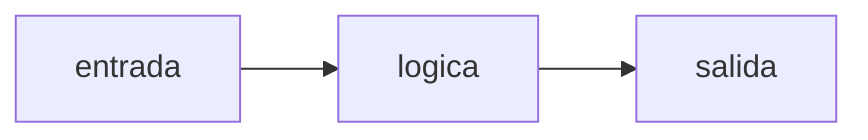

# Diseño: <feature>

## Resumen

<Qué se construye y el enfoque elegido, en 5-10 líneas.>

## Arquitectura

<Flujo de datos y piezas. Un diagrama mermaid ayuda si hay más de 3 componentes.>



## Componentes e interfaces

### <Componente A> — cubre 1.1, 1.2

- Ubicación: `ruta/al/modulo.py`
- Responsabilidad: <una sola>
- Interfaz:
  ```python
  def funcion(param: Tipo) -> TipoRetorno: ...
  ```

## Modelos de datos

<Estructuras, tablas/columnas con tipo, formatos de archivo, llaves y granularidad.>

## Manejo de errores

| Situación | Comportamiento | Criterio |
|---|---|---|
| <entrada vacía> | <qué pasa> | 2.1 |

## Estrategia de pruebas

- Unitarias (pytest): <qué funciones, con qué fixtures>
- Integración / validaciones SQL: <conteos, duplicados, totales contra fuente>
- Qué NO se prueba automáticamente y cómo se verifica

## Decisiones y alternativas

- <Decisión>: <por qué>; descartado <alternativa> porque <razón>.
